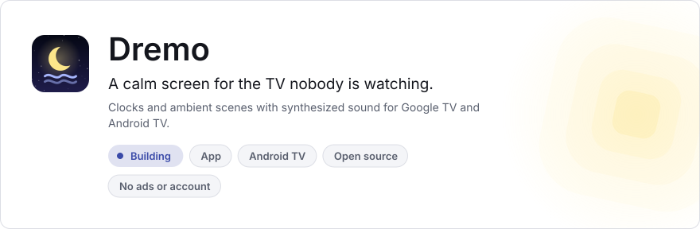
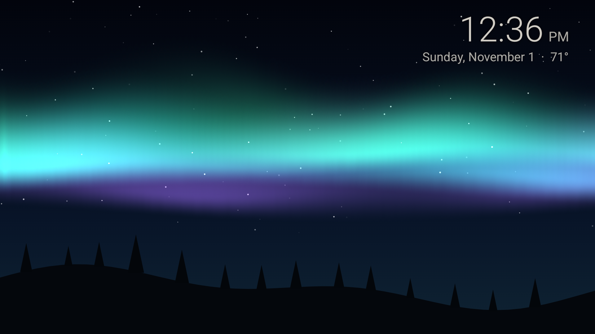
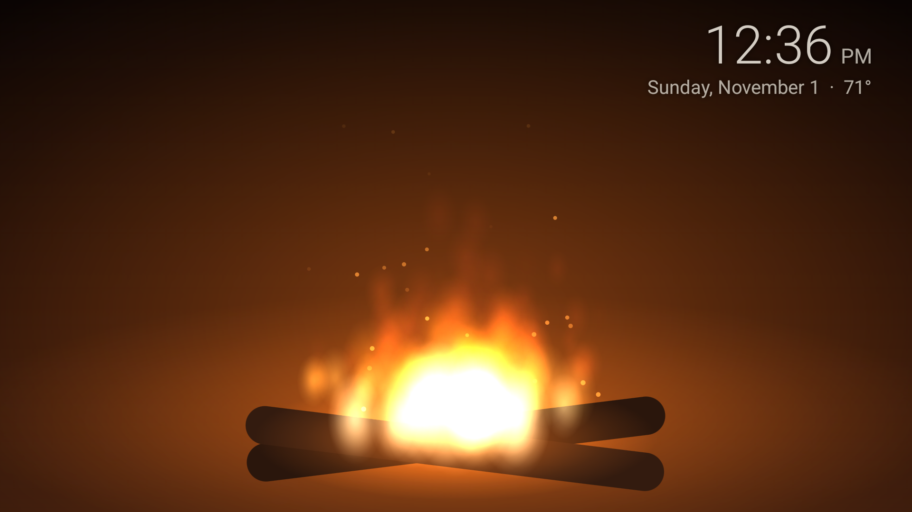
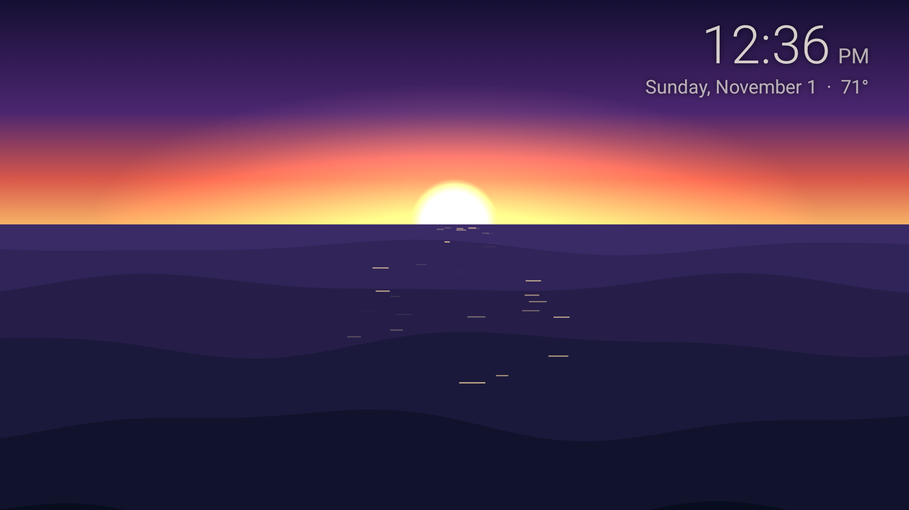
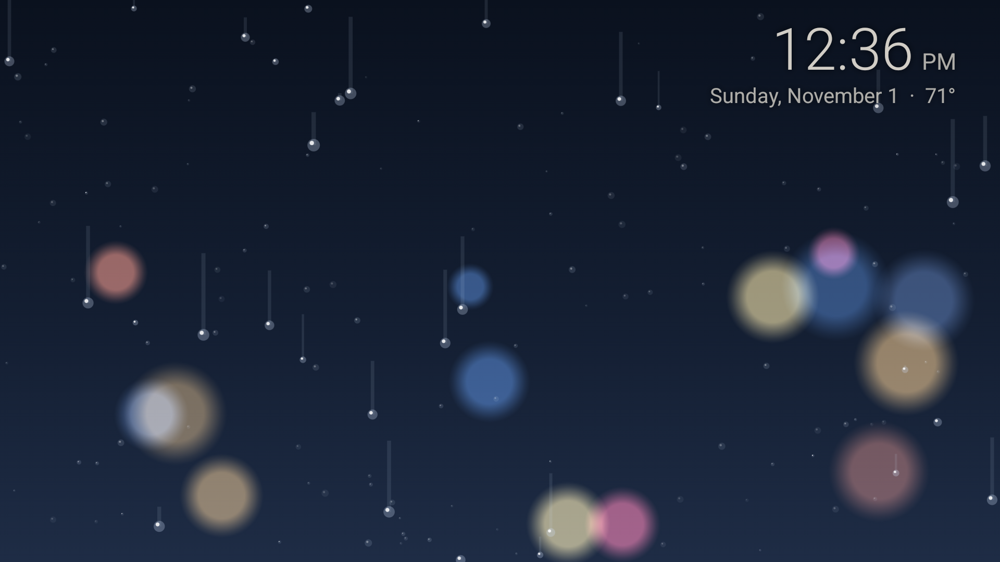
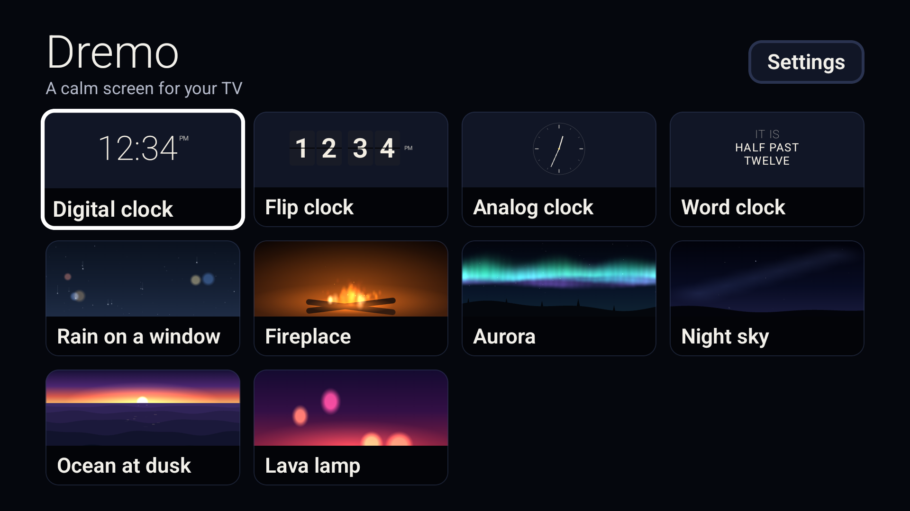
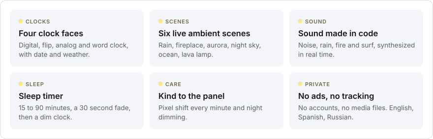
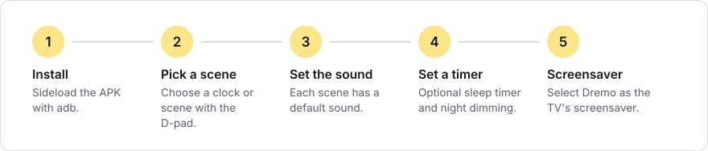

<!-- Pictures: docs/readme/spec.json, drawn by readme-kit. Do not edit the SVGs by hand. -->
<picture><source media="(prefers-color-scheme: dark)" srcset="docs/readme/hero-dark.svg"></picture>

**When the TV is on and nobody is watching, Dremo shows a big clock or a slow scene with soft sound.**
Every picture and sound is generated in code, so there are no video or audio files and no asset licences.
It is built for the living room: large type and full D-pad control. Status: building.

[Docs](docs/index.md) · [Privacy](docs/privacy.md) · [Roadmap](docs/ROADMAP.md)

<p align="center">
  
</p>
<p align="center">
  
  
  
  
</p>

## What it does

<picture><source media="(prefers-color-scheme: dark)" srcset="docs/readme/highlights-dark.svg"></picture>

- **Word clock.** Available in English and Spanish, with a date line and an optional weather line.
- **Frame rate.** Scenes use a modest particle count, so a Mi Box S-class TV keeps 30 fps or more.
- **Volume.** Ten steps. White, pink and brown noise are also available as sounds.
- **Night schedule.** 23:00 to 07:00 by default; the screen dims to about 40 percent.
- **Screen on.** The TV stays awake only while a scene runs.
- **Screensaver.** A `DreamService`. Settings > Use as screensaver shows the `adb` command that selects it and the one that restores the default.
- **Weather (optional).** Pick a city; the forecast comes from Open-Meteo.

The name comes from the Russian "дремать" (to doze) and "dream", the name of Android's screensaver API.

## How it works

<picture><source media="(prefers-color-scheme: dark)" srcset="docs/readme/steps-dark.svg"></picture>

Scenes run a frame loop capped at their frame rate and invalidate only the draw phase, so recomposition stays out of the hot path. The weather forecast is always fetched in Celsius and converted when shown.

<details><summary>Where each piece lives</summary>

Paths are under `app/src/main/kotlin/com/fabriquefutur/dremo/`.

| Piece | Where |
|---|---|
| Pure logic (sleep timer, night schedule, pixel shift, word clock, clock text) | `core`, `clock` |
| Sound synthesis and the `AudioTrack` writer | `audio/` |
| Scenes: preallocated particles, pre-rendered soft sprites, no per-frame allocation | `scene/` |
| Weather: Open-Meteo client, parser, cache, refresh policy | `weather/` |
| Settings in DataStore | `data/` |
| Screens (Compose for TV) and the screensaver | `ui/`, `dream/` |

</details>

## Quick start

```sh
git clone https://github.com/zaitsew/dremo && cd dremo
echo "sdk.dir=$HOME/Library/Android/sdk" > local.properties   # your Android SDK path
./gradlew :app:assembleDebug                                   # needs JDK 17 or newer
adb connect <tv-ip>:5555                                       # TV: Settings > Developer options > Network debugging
adb install -r app/build/outputs/apk/debug/app-debug.apk       # then open Dremo from the TV launcher
```

## Privacy

No analytics, no ads, no crash-reporting SDK, no accounts and no Google Play Services. The app asks for no location permission. Settings and the last forecast stay on the TV.

The only network traffic is the optional weather: when you pick a city, its coordinates go to Open-Meteo, which needs no key. Full policy: [docs/privacy.md](docs/privacy.md).

Weather data by [Open-Meteo.com](https://open-meteo.com/) (CC BY 4.0).

## Develop

```sh
export JAVA_HOME=~/.local/jdk-21.0.12.1+1/Contents/Home   # or any JDK 17+
./check.sh            # unit tests, lint, debug APK
./check.sh usage      # prints telemetry=none
swift tools/make-banner.swift   # redraws the banner, icon and store graphics (macOS)
```

## Docs

| Document | What is in it |
|---|---|
| [docs/index.md](docs/index.md) | Project site front page |
| [docs/privacy.md](docs/privacy.md) | Privacy policy |
| [docs/ROADMAP.md](docs/ROADMAP.md) | The plan |
| [docs/PLAY-STORE.md](docs/PLAY-STORE.md) | Play Console answers |
| [docs/play/listing](docs/play/listing) | Play listing texts (English, Spanish, Russian) |

## License

MIT, see [LICENSE](LICENSE). Copyright Fabrique Futur.



<sub>Built by <a href="https://github.com/zaitsew">zaitsew</a> with a fleet of AI agents.</sub>
